# ASC PremosCorp — Diagramas de Flujo
> Versión 2.0 | Actualizado: 2026-06-12
> Módulos activos: P01–P27 (Correlation Engine)
> Los diagramas usan sintaxis Mermaid (renderizable en GitHub, GitLab, Notion, VS Code)

---

## 1. Flujo Principal: Evento → Alerta → Neutralización

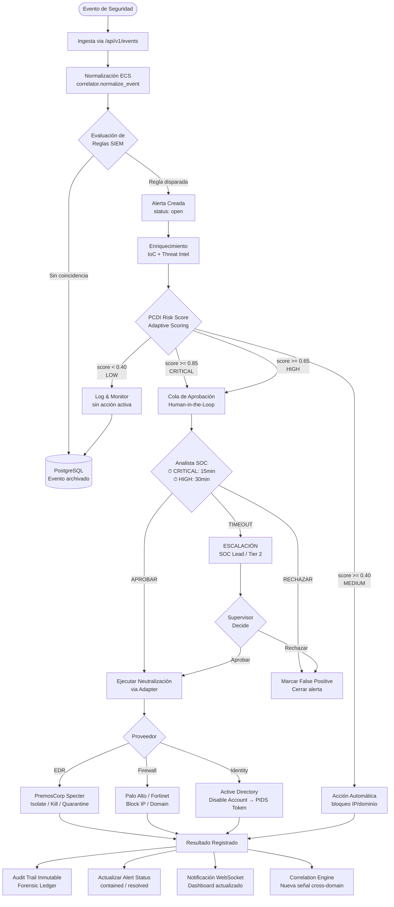

---

## 2. Flujo de Aprobación Human-in-the-Loop (PANL — Detalle)

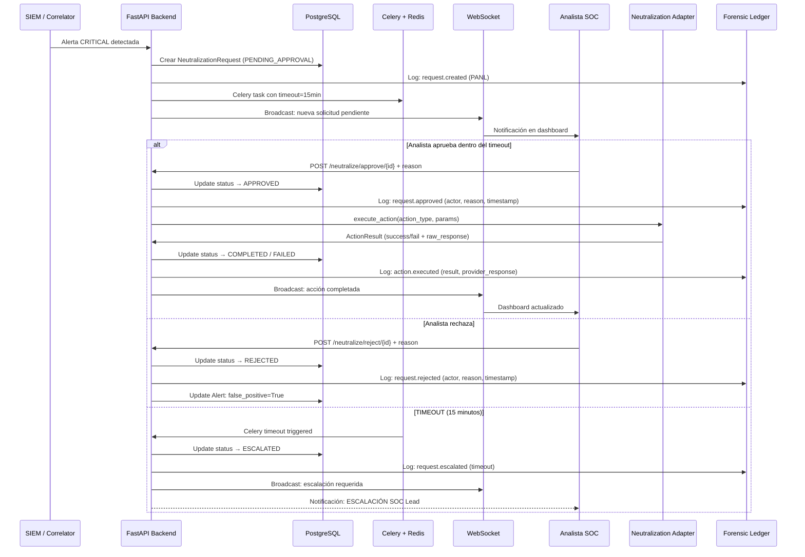

---

## 3. Flujo: Análisis de Artefacto → Respuesta Automática

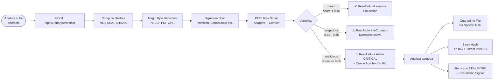

---

## 4. Flujo: SPECTER Agent — Pipeline de Comando

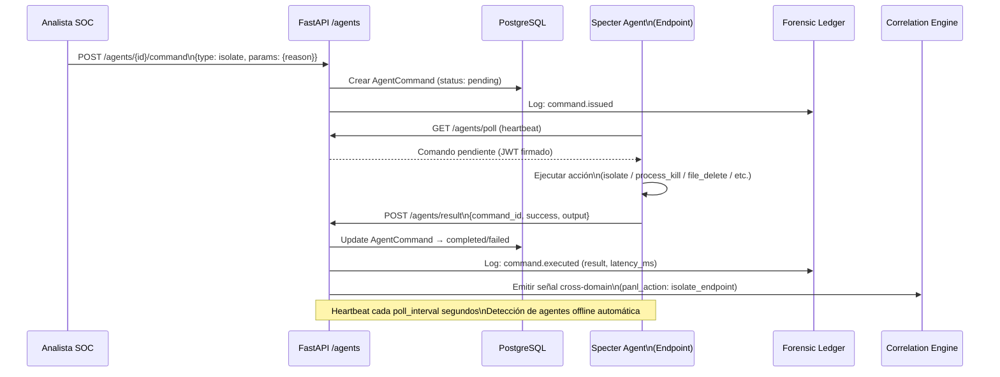

---

## 5. Flujo: Bloqueo IP — Palo Alto (Detalle Técnico)

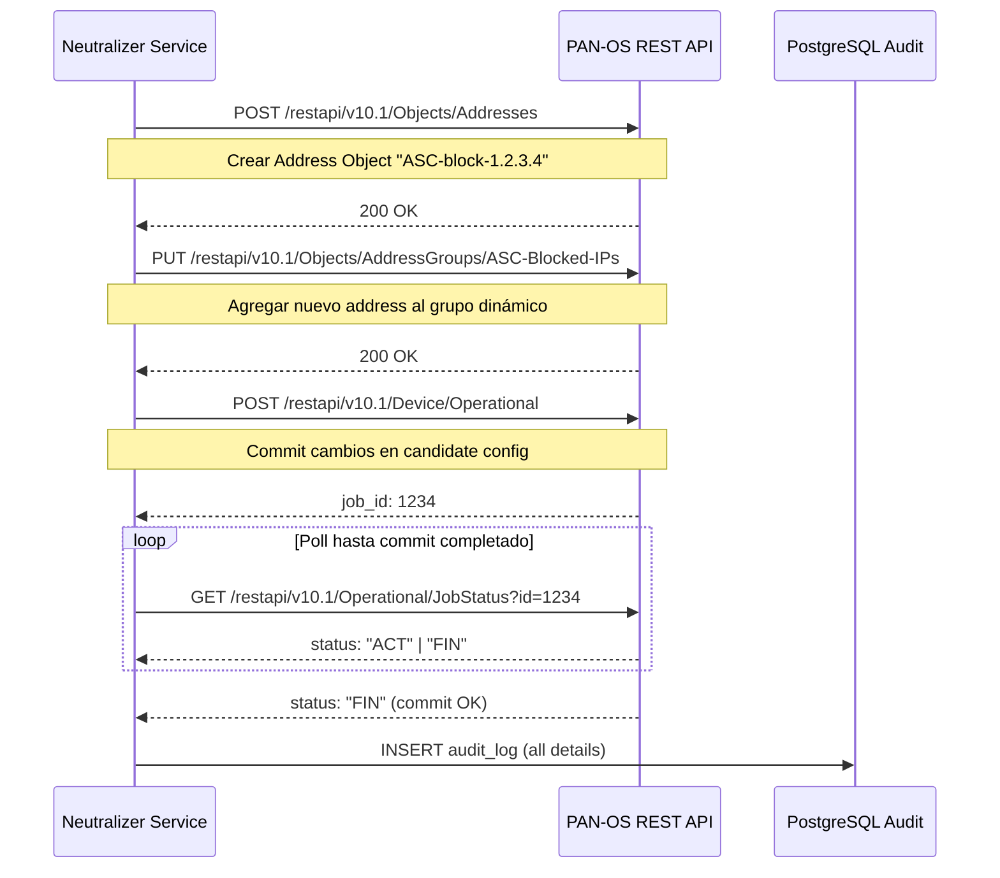

---

## 6. Flujo: SOAR + PIDS — Identity Response (P25/P26)

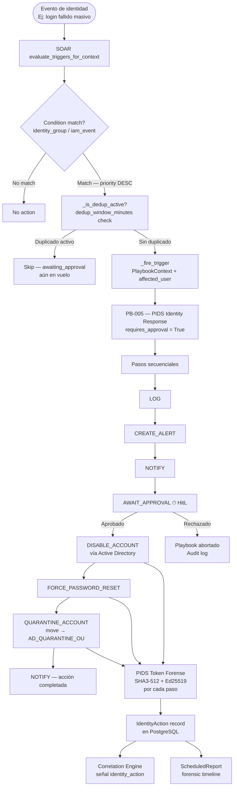

---

## 7. Flujo: Correlation Engine — Sweep Cross-Domain (P27)

```mermaid
flowchart TD
    BEAT([Celery Beat\ncada 15min]) --> SWEEP[run_correlation_sweep]
    MANUAL([POST /correlation/sweep\nAdmin manual]) --> SWEEP

    SWEEP --> RULES[Cargar CorrelationRules\nenabled = True]

    RULES --> R1[R001: host_pivot\n≥3 señales / 60min]
    RULES --> R2[R002: identity_pivot\n≥2 señales / 120min]
    RULES --> R3[R003: ip_pivot\n≥2 señales / 60min HIGH+]
    RULES --> R4[R004: domain_pivot\n≥2 señales / 60min]

    R1 --> GATHER[_gather_X_signals\nwindow_start = now - time_window]

    subgraph GATHER_HOST[host_pivot sources]
        G1[Event.host]
        G2[Alert.affected_hosts JSON list]
        G3[HuntFinding.affected_host]
        G4[PANL isolate_endpoint.target]
    end

    subgraph GATHER_IDENTITY[identity_pivot sources]
        GI1[IdentityAction.username@domain]
        GI2[HuntFinding.affected_user]
    end

    subgraph GATHER_IP[ip_pivot sources]
        GIP1[Event.normalized src_ip/dst_ip]
        GIP2[ThreatIntelIndicator type=ip]
        GIP3[PANL block_ip.target]
    end

    GATHER --> FILTER[Filtrar por severity_threshold]
    FILTER --> GROUP[Agrupar por pivot_value]
    GROUP --> CHECK{signal_count\n>= min_signals?}

    CHECK -->|No| SKIP[Skip — señal insuficiente]
    CHECK -->|Sí| UPSERT[_upsert_cluster]

    UPSERT --> DEDUP[Deduplicar señales\npor signal_type + signal_id]
    DEDUP --> AGGR[Recompute:\n• severity = max\n• distinct_signal_domains\n• is_campaign ≥3 tipos\n• confidence_score\n• forensic_hash SHA3-512]

    AGGR --> CAMPAIGN{distinct_signal_domains\n≥ 3?}
    CAMPAIGN -->|Sí| CAMP[is_campaign = True\ncampaign_name auto-generado]
    CAMPAIGN -->|No| STORE[CorrelationCluster updated]
    CAMP --> STORE

    STORE --> GRAPH[GET /correlation/clusters/{id}/graph\nNodes + Edges por signal_type]
    STORE --> ANALYST[Dashboard /correlation\nKPIs + tabla + expand graph]
```

---

## 8. Flujo: Threat Hunting — Hypothesis to Finding (P22)

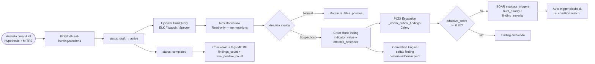

---

## 9. Flujo: Threat Intelligence — Ingesta y Enriquecimiento (P21)

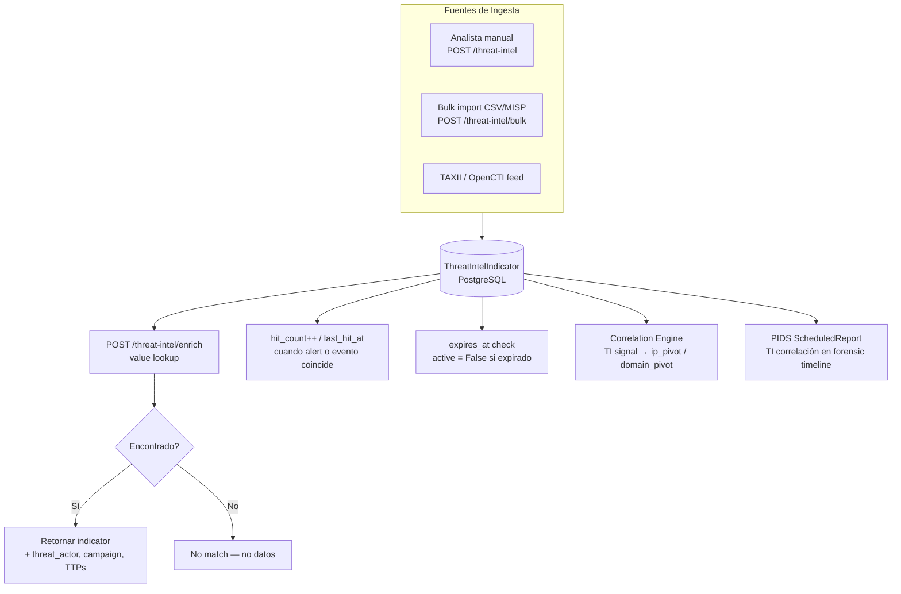

---

## 10. Flujo: Forensic Ledger — Cadena de Custodia (P19)

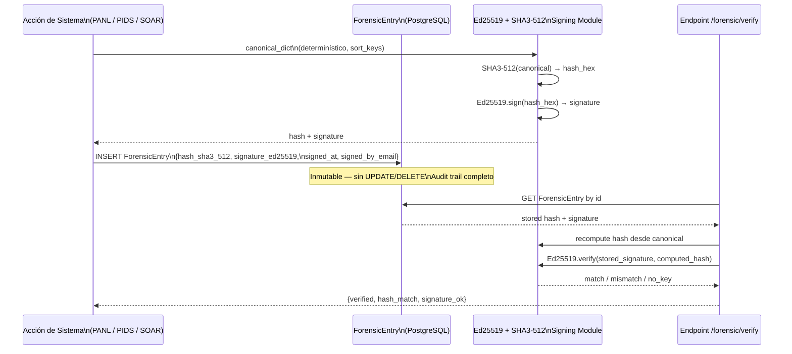

---

## 11. Arquitectura Completa ASC — Vista de Sistema (v2.0)

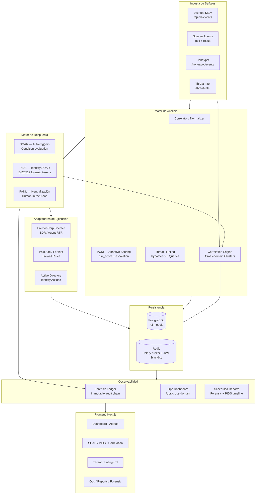

---

## 12. Pipeline CI/CD con Security Gates

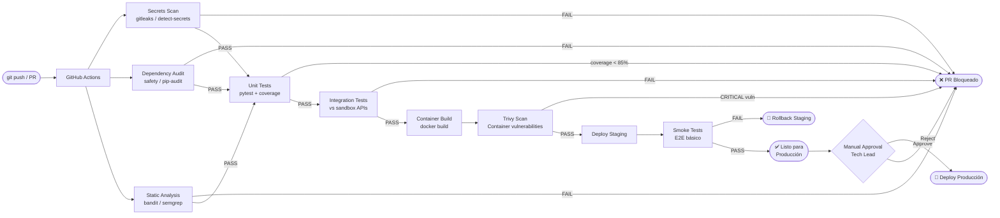

---

## Índice de Módulos — Estado Actual (P27)

| Módulo | Descripción | Estado |
|--------|-------------|--------|
| P01–P15 | Core platform, auth, RBAC, events, alerts, neutralización base | ✅ Completado |
| P16 | PANL — Human-in-the-Loop + multi-firma + rollback | ✅ Completado |
| P17 | SPECTER Agents — fleet command + heartbeat | ✅ Completado |
| P18 | Honeypot — traps passivos, detection, evidencia | ✅ Completado |
| P19 | Forensic Ledger — cadena de custodia Ed25519 + SHA3-512 | ✅ Completado |
| P20 | Ops Dashboard — fleet health, cross-domain metrics | ✅ Completado |
| P21 | Threat Intelligence — indicadores, enriquecimiento, bulk import | ✅ Completado |
| P22 | Threat Hunting — sessions, findings, queries read-only | ✅ Completado |
| P24 | PCDI — Adaptive scoring, Celery escalation, MITRE context | ✅ Completado |
| P25 | SOAR — Auto-triggers, playbooks, condition engine | ✅ Completado |
| P26 | PIDS — Identity SOAR, forensic tokens, scheduled reports | ✅ Completado |
| P27 | Correlation Engine — cross-domain clusters, campaigns, graph | ✅ Completado |
| **P28** | **Próximo módulo — por definir** | 🔲 Planificación |
